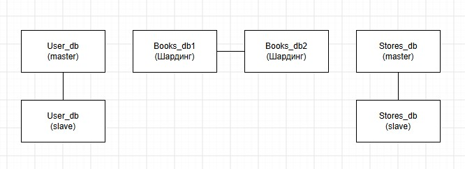

## Задание 1

Схема 1: Активный master и пассивный репликационный slave

Высокая отказоустойчивость и быстрый failover;
Безопасность резервного копирования;
Простота;

Схема 2: Master и несколько slave-серверов

Масштабирование чтения;
Балансировка нагрузки;
Средняя сложность;

## Задание 2

Репликация всех БД  - Master -Slave
Горизонтальный шардинг связующей таблицы User-Books. Больше всего записей и больше всего чтения

