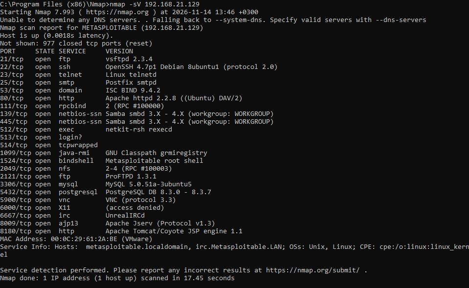
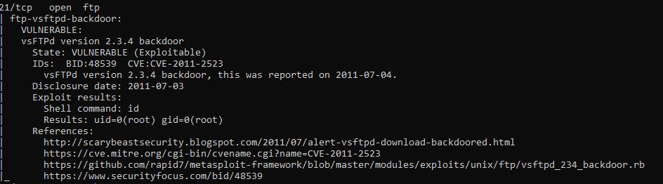
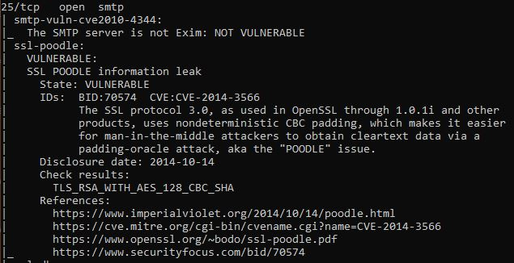
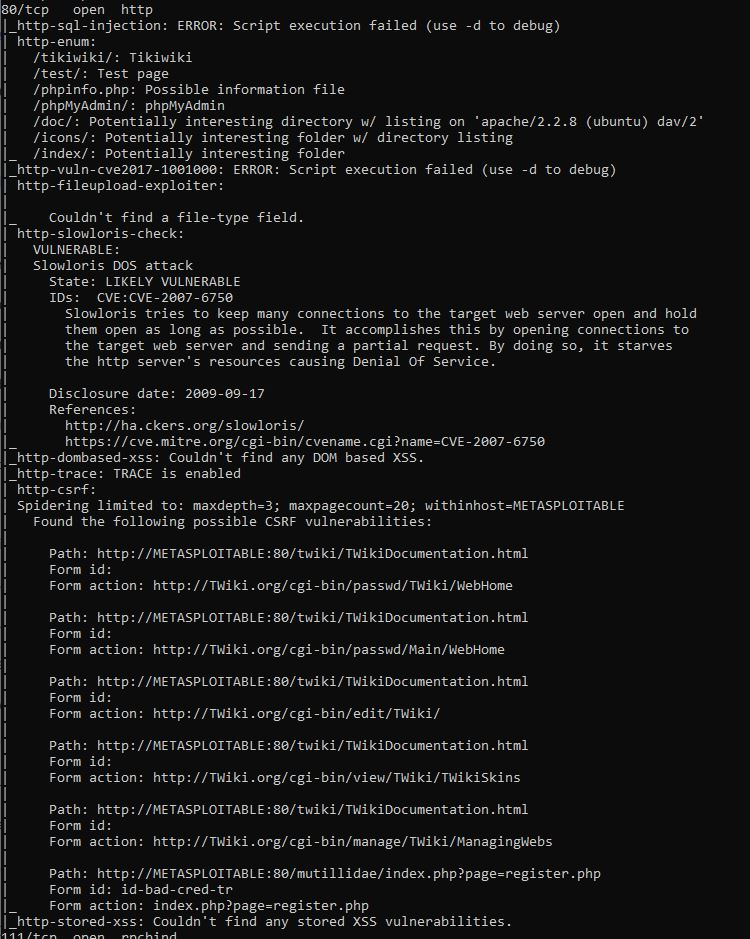

##Задание1

##Задание2

SYN (-sS) — шлём SYN. Открыт → сервер отвечает SYN+ACK (Nmap шлёт RST). Закрыт → RST. Быстро, трафика мало.

FIN (-sF) — шлём только FIN. Открыт → сервер молчит. Закрыт → RST. Работает на Unix, но не на Windows.

Xmas (-sX) — шлём FIN+PSH+URG («ёлка» из флагов). Открыт → молчит. Закрыт → RST. То же, что FIN, но заметнее в трафике.

UDP (-sU) — шлём UDP-датаграммы. Открыт → ответ данными или тишина (open|filtered). Закрыт → ICMP «port unreachable». Медленно и шумно.
